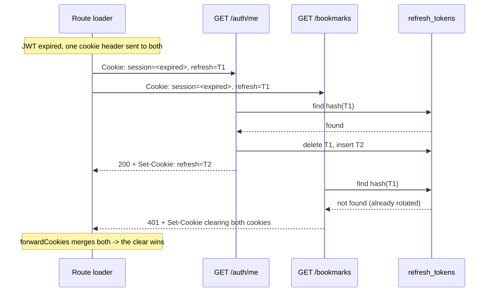

# Refresh Token Rotation and Concurrent Requests

This document describes an authentication defect discovered while building the chat feature, how the frontend now prevents it within a request, what is still **not** solved, and the options for fixing the rest.

The defect predates the chat work. It is written up here because the chat feature added requests to the pattern that triggers it. Sections 1 and 2 describe the defect as it was; section 3 describes what is in place now.

---

## 1. Background: How Sessions Work Here

Authentication lives in `backends/node-drizzle/src/auth.ts` and uses two cookies.

**The session cookie** (`session`) holds a signed JWT carrying `{ id, role }`. It expires after **one hour**. It is `httpOnly`, scoped to path `/`.

**The refresh cookie** (`refresh`) holds a 32-byte opaque random token, 64 hex characters. It expires after **30 days**, is `httpOnly` and scoped to path `/api`. The token itself is never stored: the `refresh_tokens` table keeps its SHA-256 hash, so a database leak does not hand over usable sessions. Each row also carries a `family` UUID, which groups a chain of rotations.

The `requireAuth` middleware runs this sequence:

1. If the JWT verifies, attach the session and continue.
2. Otherwise (expired or invalid), look for the refresh cookie. If absent, `401`.
3. Hash the presented token and look it up. **If no row matches, clear both cookies and return `401`.**
4. If the row has expired, delete it, clear both cookies: returning `401` too.
5. Otherwise **rotate**: delete the row that was just used, insert a replacement in the same family, set the new refresh cookie, mint a fresh JWT and continue.

Step 5 is _refresh token rotation_, and it is a genuine security improvement from using only JWTs as of those changes' time. A refresh token is a long-lived credential; rotating on every use means a stolen token is only useful until the legitimate user next makes a request, at which point the thief's copy stops working.

It also makes theft **detectable**: a token presented after it that has already been consumed indicates that two parties hold the same credential.

The important property for what follows is that **rotation is destructive and single-use**. Once a token is presented, it stops being valid, immediately and permanently.

---

## 2. The Defect

### 2.1 How React Router Loaders Talked to the API

This frontend runs server-side. A route `loader` executes in the frontend's Cloudflare Worker, reads the browser's `Cookie` header from the incoming request, and forwards it to the Hono API on each call it makes:

```ts
const cookieHeader = request.headers.get("Cookie");

const [userPropertiesRes, userBookmarksRes, userChatsRes] = await Promise.all([
  fetch(`.../users/${userId}/properties`),
  fetch(`.../users/${userId}/bookmarks`, { headers: { Cookie: cookieHeader } }),
  fetch(`.../chats`, { headers: { Cookie: cookieHeader } }),
]);
```

Responses may carry `Set-Cookie` headers. That is how a rotated refresh token reaches the browser, so those are collected and attached to the loader's own response by the `forwardCookies` utility.

Two facts combine badly:

- **Every call in a loader sends the same, original cookie header.** The loader holds a string captured from the incoming request. Nothing updates it mid-process, so a rotation that happens during call A is invisible to calls B and C.
- **Calls are concurrent.** `Promise.all` is the norm, since these requests are independent.

### 2.2 The Failure

For 59 of every 60 minutes, nothing goes wrong: the JWT is valid, `requireAuth` returns at step 1, and the refresh token is never touched.

At the hour boundary the JWT expires. The next page load fires, say, three authenticated requests in parallel, **all carrying the same now-expired JWT and the same refresh token**. All three fall through to step 3.



Whichever request reaches the database first rotates successfully. The others find nothing, and step 3 does two damaging things: it returns `401`, and it **clears the user's cookies**.

Because `forwardCookies` merges `Set-Cookie` headers from every response, the cookie-clearing headers travel to the browser alongside the good ones. The browser applies both... The user is logged out by their own page load.

There is a second interleaving, if both requests read the row before either deletes it: both rotate, two valid replacement tokens exist, and the browser keeps only whichever `Set-Cookie` was applied last. The other becomes an orphan row. Less destructive, but the table now holds tokens that no client will ever present.

### 2.3 Sequential Calls Do Not Escape It

Making the calls sequential is not sufficient.

The profile loader awaits `/api/auth/me` first, and only then issues the rest. The first call rotates and returns a new token, but it returns it in a **response header**. The loader's `cookieHeader` variable still holds the original string. Every subsequent call therefore presents the token that was just consumed, and lands squarely on step 3.

So ordering alone does not help. The loader would have to parse the `Set-Cookie` from the first response and rebuild the header for the rest. Before the middleware described in section 3, nothing did that.

### 2.4 In Conclusion

In production, with users leaving tabs open, it would surface as intermittent unexplained logouts, the kind of bug that is reported vaguely and reproduced with difficulty.

At the time, a single profile page load made up to seven authenticated calls: `/auth/me` and `/chats/unread-count` from the root loader, then `/auth/me`, bookmarks, chats and the open thread from the profile loader, with the root and profile loaders running in parallel. The chat panel also revalidated every loader on the page every 8 seconds, multiplying the chances of landing on the hour boundary.

---

## 3. What Is in Place Now

The frontend now applies option **4.2** (a single refresh point per request) through React Router middleware, and the pages make fewer authenticated calls overall.

### 3.1 One `/auth/me` per Request

`frontend/app/utils/auth.ts` defines `authMiddleware`, registered on the root route in `frontend/app/root.tsx` (it needs the `v8_middleware` future flag in `frontend/react-router.config.ts`). Middleware wraps every request the frontend Worker handles: document requests, client-side `.data` requests, actions and resource routes.

For each request, the middleware stores a lazy, memoized function in the router context. Loaders and actions call `getAuth(context)` instead of fetching `/api/auth/me` themselves:

```ts
export async function loader({ context }: Route.LoaderArgs) {
  const { user, cookie } = await getAuth(context);

  if (!user) return redirect("/log-in");

  // `cookie` is what to send to the backend from here on
  const chatsRes = await fetch(API_URL + "/api/chats", {
    headers: { Cookie: cookie },
  });
  // ...
}
```

- **At most one call.** Every loader of the request shares the same promise, so the root loader and a route loader running in parallel trigger a single `/auth/me` call, and therefore at most one rotation.
- **Only when needed.** Nothing is fetched until a loader or action asks. Navigations that don't rerun the root loader, and resource routes such as `/chat-updates`, cost no `/auth/me` call.
- **Skipped for anonymous visitors.** Without a `session` or `refresh` cookie in the request, no backend call is made at all.
- **A rebuilt cookie header.** When `/auth/me` rotates, `getAuth` returns the incoming `Cookie` header with the new `session` and `refresh` values swapped in. Calls made afterwards present the fresh JWT, verify at step 1, and never touch the refresh token. This is the fix section 2.3 called for.
- **Forwarded exactly once.** After the request has been handled, the middleware appends that `/auth/me` response's `Set-Cookie` headers to the final response, once. Loaders no longer forward it themselves.
- **Failures forward nothing.** A failed `/auth/me` counts as anonymous, and its cookie-clearing headers are dropped.

The earlier guard stays in place for the other calls: loaders only pass a backend response to `forwardCookies` when it succeeded. With the rebuilt cookie header those calls normally set no cookies at all.

### 3.2 Fewer Calls to Race With

- `/api/auth/me` now also returns `unreadSenders`, so the root loader no longer calls `/api/chats/unread-count` (that endpoint is gone).
- The chat panel no longer revalidates every loader on a timer. It polls the `/chat-updates` resource route, which makes exactly one backend call to `/api/chats/poll`.

### 3.3 The Refresh Cookie Never Reaches the Frontend

The `refresh` cookie is set with `Path=/api`. The frontend copies backend `Set-Cookie` headers onto its own responses unchanged, so the browser stores `refresh` for the **frontend's** host with `Path=/api`. The frontend has no routes under `/api`, so the browser never sends that cookie on a page request.

Meanwhile, the `session` cookie's `Max-Age` equals the JWT's one-hour lifetime, so the browser drops it at the same moment the JWT expires. After an hour, page requests therefore carry neither cookie. The silent refresh in step 5 never happens through the frontend, and the user appears logged out.

In practice this means the race in section 2 can't currently be triggered by a browser through the frontend; it only applies to clients that hold the refresh cookie, such as direct API callers or the backend tests. It also means sessions on the site effectively last one hour, not 30 days. Fixing this means changing the cookie paths (for example, setting the refresh cookie for a path the frontend's requests use, or rewriting its `Path` when forwarding). Once that's done, the protections in section 3.1 matter in practice.

### 3.4 What It Does Not Fix

- **Separate requests can still race.** The single refresh point is per request. Two tabs, or a poll tick and a page navigation arriving together, are separate requests and can still present the same refresh token concurrently. Only a backend-side fix (4.1, 4.6) covers that.
- **Actions that skip `getAuth` still send the raw cookie.** The profile page's actions (password change, profile edit, listings, messages, logout) forward the incoming `Cookie` header directly. Each makes a single backend call, so there's no race within the request, but it still exposes them to the cross-request race above.
- **The orphan-row interleaving is untouched.** Concurrent rotations can still strand rows in `refresh_tokens`.

---

## 4. Options for a Fuller Fix

### 4.1 A Rotation Grace Window

The most commonly deployed answer and the smallest change.

Rather than deleting a token on rotation, mark it consumed a `rotatedAt` timestamp and a `replacedBy` reference. A token presented within a short grace window (10 to 30 seconds) after being consumed is accepted, and the caller receives the **same** replacement the first caller was given, instead of triggering another rotation.

Concurrent requests then all succeed, all end up on the same token, and no cookies are cleared. Unlike 4.2, this also covers races between separate requests.

The cost is a slightly widened theft window: a stolen token remains usable for the grace period after legitimate use. It is what most identity providers do anyhow.

It also **enables proper theft detection**, which the current code cannot do. Today, when step 3 finds no matching row, it has no way to know whether the token was stolen, already rotated, or never valid; an unknown hash maps to no family, so nothing can be revoked. Keeping consumed tokens around means a replay _outside_ the grace window can be recognised precisely, and the entire `family` revoked in response.

This needs a schema change to `refresh_tokens`.

### 4.2 Refresh at a Single Point per Request (Implemented)

Prevent the concurrency within a request instead of tolerating it: guarantee that exactly one call per request can rotate, and rebuild the cookie header for every call after it.

This is what section 3.1 describes. The cost anticipated here was real but small: loaders that need the user wait for `/auth/me` before their own authenticated calls, which the profile loader already did. Public calls, such as the property and its agent on the property page, still run without waiting.

### 4.3 Aggregate Endpoints

The structural fix: if a route needs one backend request, there is no concurrency to lose to.

Rather than the profile page making four or five calls, the backend exposes one endpoint that assembles what the page needs, authenticating once. This is the Backend-for-Frontend pattern, and it removes the problem by construction while also cutting round trips.

`GET /api/chats/poll` is a small instance of this: one poll tick fetches the chat list, the unread badge and the open thread in a single call. `/api/auth/me` returning `unreadSenders` is another.

The cost is coupling: endpoints shaped around screens rather than resources drift as the UI changes, and the REST API stops being a clean resource model, which matters in this project specifically, since this repository exists partly to reimplement the same API in other stacks.

### 4.4 Single-Flight Locking on the Server

Serialise refreshes inside `requireAuth`: keeping a map of in-flight rotations keyed by family, and have concurrent callers await the first one's result rather than starting their own.

This doesn't work on Cloudflare Workers as deployed: requests are spread across many isolates and locations, so an in-memory map only sees the requests that happen to share an isolate. It would need shared coordination, such as a Durable Object per family or a database-level guard. Possible, but heavier than 4.1.

### 4.5 Rotate Less

Rotate only when the refresh token is nearing expiry, rather than on every use, or drop rotation for a plain sliding-expiry session.

This makes the race condition rare instead of routine, but it does not eliminate it, and it gives up the security property that motivated rotation in the first place. I mention it for completeness or lack of any other ideas.

### 4.6 Stop Clearing Cookies on a Failed Refresh

Independently of the above, step 3 could be made less aggressive: return `401` without `clearAuthCookies`, and let the client decide whether to send the user to the log-in page.

Clearing cookies server-side turns one failed request into a destroyed session, which is precisely the blast radius that made this defect painful. A failed refresh is evidence about _that request_, not proof that the session is invalid. This is a small change, it composes with any of the options above and it could prevent the logout on its own.

---

## 5. Planned Solution

Within a request, **4.2** is now in place (section 3.1).

For races between requests, the plan is still to combine **4.1** and **4.6**: add a grace window with proper family revocation on genuine replay, and stop clearing cookies when a refresh lookup fails. Together they address the cause rather than the symptom and keep the security benefit of rotation.

Before either matters to real users, the refresh cookie path issue in section 3.3 has to be fixed; until then, browsers never present a refresh token through the frontend.

---

## References

- `backends/node-drizzle/src/auth.ts`: `requireAuth`, `createRefreshToken`, `rotateRefreshToken`, `clearAuthCookies`; steps 3 to 5 above are the relevant region, and the `path: "/api"` on the refresh cookie is the one section 3.3 is about.
- `shared/src/schema.ts`: the `refreshTokens` table, including the `family` column that a proper reuse-detection implementation would use.
- `frontend/app/utils/auth.ts`: `authMiddleware` and `getAuth`, the single refresh point per request (section 3.1).
- `frontend/app/root.tsx`: registers `authMiddleware` and reads the user and badge through `getAuth`.
- `frontend/app/utils/forwardCookies.ts`: merges `Set-Cookie` headers from backend responses; loaders only pass it successful responses.
- `frontend/app/routes/user-profile.tsx`, `property-item.tsx`, `our-agents.tsx`: loaders and actions that use `getAuth` and its rebuilt cookie header.
- `frontend/app/routes/chat-updates.ts` and `GET /api/chats/poll`: the single-call poll that replaced whole-page revalidation (section 3.2).
